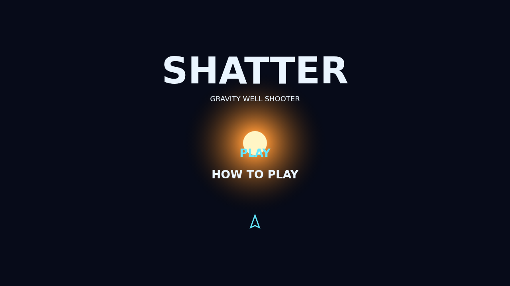

# Shatter

Shatter is a gravity-well rock shooter where every pull of the trigger matters.
Fly on momentum, turn hard, and send a stream of shots through the bright heart
of the field.

Large rocks wear armor and split into faster fragments. Clear the whole swarm to
call in a denser wave, while a hunting saucer crosses the field looking for a
clean angle.

The star bends bullets and rocks but never takes your controls away. Curve a
shot around its halo, or launch the single guided torpedo when a stubborn rock
has to disappear now.

